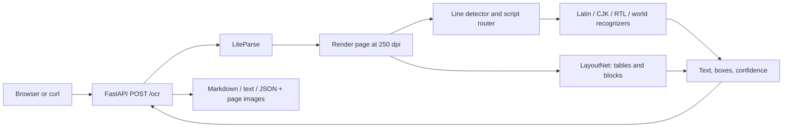

<div align="center">

# OCRia nano-1 · Local OCR API


**Document OCR that stays on your machine.** Upload a PDF or image, get Markdown, text, or JSON with boxes — plus a browser UI that draws the model's layout regions over each page.

[Highlights](#highlights) · [Quick start](#quick-start) · [Web UI](#web-ui) · [API](#api) · [How it works](#how-it-works) · [License](#license)

</div>

## Highlights

- **Tiny and local** — 8.1M-parameter ONNX pipeline from LlamaIndex, running on CPU through [LiteParse](https://github.com/run-llama/liteparse). No cloud OCR calls.
- **Multilingual** — a router sends each text line to a Latin, CJK, RTL, or world-script recognizer.
- **Layout aware** — tables, headings, lists, and figures come back as classified blocks with bounding boxes.
- **Two ways in** — a drag-and-drop web page, or a single `POST /ocr` for scripts.
- **Three ways out** — Markdown, plain text, or JSON with geometry and per-confidence text lines.
- **Fast on ordinary documents** — digital PDFs keep their text layer, so most pages need no OCR at all.

## Quick start

Requires Python 3.14+ and [uv](https://docs.astral.sh/uv/).

```bash
git clone https://github.com/<your-username>/ocria-nano-1-example.git
cd ocria-nano-1-example
uv sync
uv run ocria-api
```

Open <http://localhost:8055>. On first startup, LiteParse pulls the `ocria-nano` models (about 35 MB of weights plus ONNX Runtime, cached under `~/.cache/liteparse`). Later starts reuse the cache.

For development with auto-reload:

```bash
uv run uvicorn ocria_nano_1_example.app:app --port 8055 --reload
```

| Environment variable | Default | Meaning |
| --- | --- | --- |
| `PORT` | `8055` | Port used by `uv run ocria-api`. |
| `OCRIA_AUTO_PULL` | `1` | Set to `0` to skip the model pull check at startup. |

## Web UI

The page at `/` has two areas:

1. **Upload** — click the drop zone to browse, or drag a file onto it. PDF, PNG, JPEG, TIFF, BMP, WebP, DOCX, PPTX, XLSX; up to 50 MB. Pick an output format and press **OCR it!**
2. **Results** — the **Recognized text** tab shows the parsed text with Copy and Download buttons. The **Layout** tab shows each rendered page with colored boxes over the regions the model found, plus toggles for layout blocks and individual text lines and a color legend.

Hover a box to see its kind, text, and OCR confidence.

## API

```bash
curl -X POST "http://localhost:8055/ocr?output_format=markdown" \
  -F "file=@scan.pdf"
```

Layout and page previews for the UI overlay:

```bash
curl -X POST "http://localhost:8055/ocr?output_format=json&visual=true" \
  -F "file=@scan.pdf"
```

| Endpoint | Description |
| --- | --- |
| `GET /` | Browser UI. |
| `GET /health` | Status, backend name, and whether models are ready. |
| `POST /ocr` | Parse an uploaded document. Interactive docs at `/docs`. |

`POST /ocr` query parameters:

| Parameter | Values | Default |
| --- | --- | --- |
| `output_format` | `markdown`, `text`, `json` | `markdown` |
| `extract_blocks` | `true`, `false` | `false` |
| `visual` | `true`, `false` | `false` |

The response has `filename`, `format`, and `text`. `extract_blocks` adds flat `blocks`; `visual` adds `pages`, where each page contains `page_num`, `width`, `height`, a base64 PNG `image`, layout `blocks` (`kind`, `text`, `[x, y, width, height]`), and per-line `items` with confidence.

## How it works



The model is a pipeline of small ONNX models, not a single VLM:

| Component | File | Role | Params |
| --- | --- | --- | --- |
| Line detector | `det.onnx` | Text-line segmentation | 0.08M |
| Script router | `router.onnx` | Picks a recognizer per line | 0.04M |
| Latin recognizer | `rec_latin.onnx` | CTC, 791 characters | 0.80M |
| World recognizer | `rec_world.onnx` | ~17 scripts | 0.98M |
| RTL recognizer | `rec_rtl.onnx` | Arabic, Hebrew | 0.71M |
| CJK recognizer | `rec_cjk.onnx` | Chinese, Japanese, Korean | 1.27M |
| LayoutNet | `tablenet.onnx` | Tables, rows, columns, 13 layout classes | 4.27M |
| **Total** | | | **8.1M** |

For PDFs with an embedded text layer, LiteParse merges that text instead of recognizing pixels; OCR runs only where text is missing. A 3-page digital CV parsed in about 0.8 s locally. The model card quotes 426 ms/page on one CPU core and 27.8 pages/s on 16 vCPUs for scanned pages.

## Project structure

```text
src/ocria_nano_1_example/
├── app.py                 # FastAPI app, /ocr endpoint, visual page data
└── static/
    └── index.html         # Self-contained dark-mode UI (HTML + CSS + JS)
pyproject.toml             # uv project and dependencies
uv.lock                    # Locked dependency set
```

## License

The **project code** is [MIT licensed](LICENSE).

The **model weights** are not: `llamaindex/OCRia-nano-1` uses the `ocria-nano-1-license`, based on AI Pubs Open RAIL-M. It allows research, personal use, and commercial use by organizations under **$2M annual revenue and $2M total funding**. A commercial license is required above those thresholds and for document-parsing products that compete with LlamaParse or LlamaCloud. LiteParse itself is Apache 2.0. Read the [model card](https://huggingface.co/llamaindex/OCRia-nano-1) before using the weights. Outputs belong to you.

## Credits

- [LlamaIndex](https://www.llamaindex.ai/) for OCRia-nano-1 and [LiteParse](https://github.com/run-llama/liteparse).
- [OCRia-nano-1 model card](https://huggingface.co/llamaindex/OCRia-nano-1) and [technical report](https://www.llamaindex.ai/ocria/ocria-nano-1-report.pdf).
